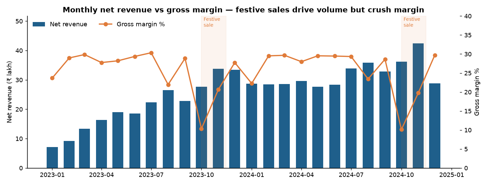
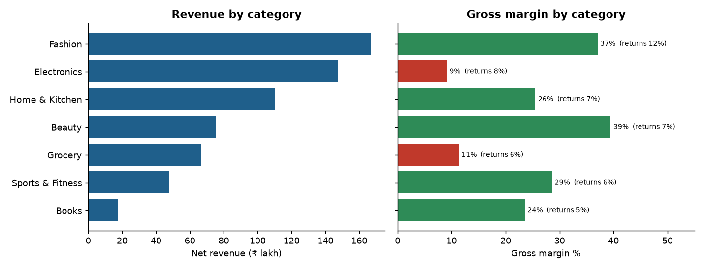
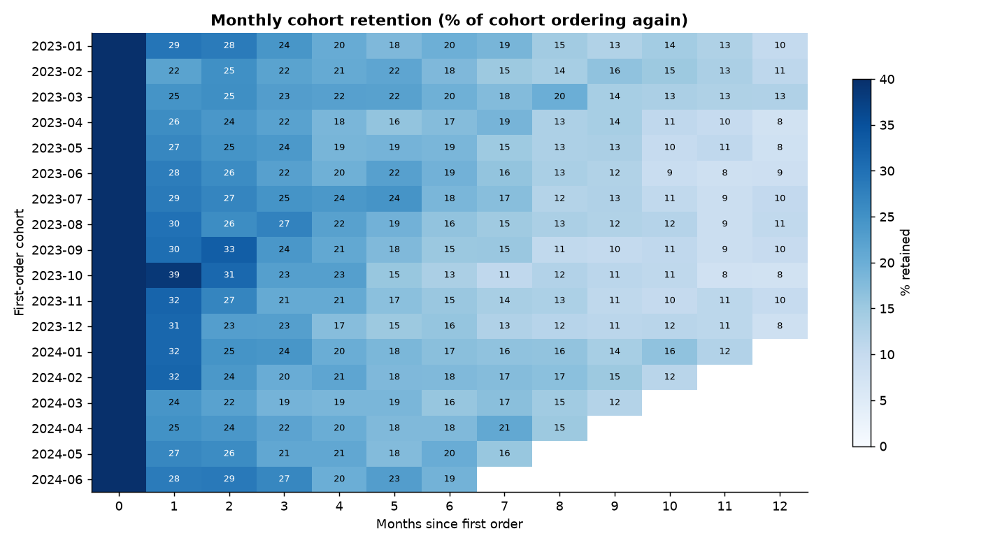
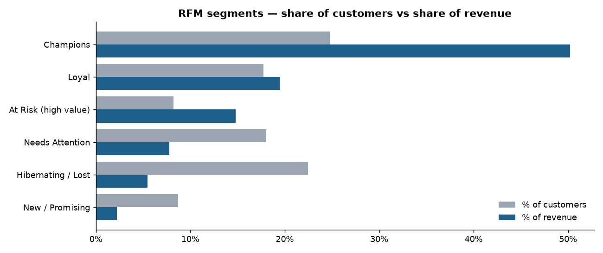
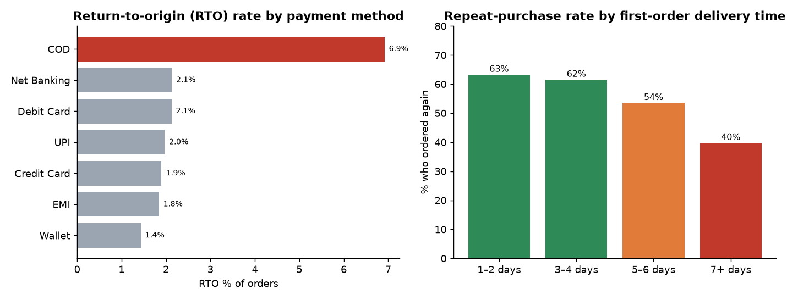
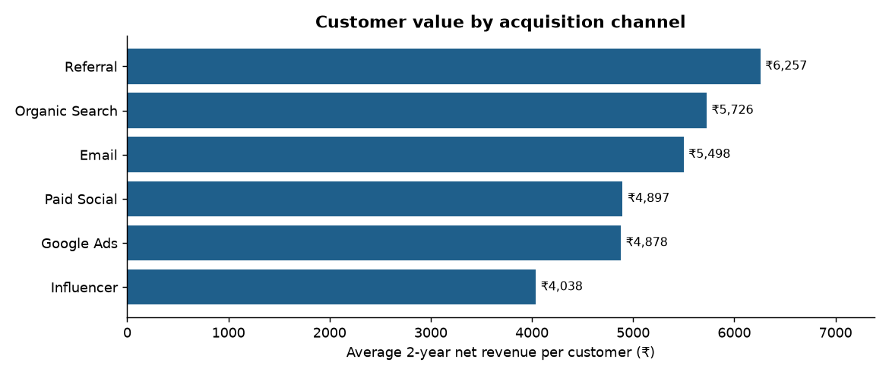

# ShopKart India: Sales & Customer Analytics Report (FY 2023–2024)

**Prepared for:** Head of Growth & CFO  **Analyst:** K. Manohar  **Data:** 52,039 orders · 81,127 line items · 12,000 customers · 587 products

> Note: ShopKart India is a fictional company. The dataset is synthetic but was built to behave like a real Indian e-commerce business: festive-sale spikes, COD risk, Tier-2 delivery delays, and category-level margins.

---

## 1. Executive summary

| KPI | 2023 | 2024 | YoY |
|---|---|---|---|
| Net revenue | ₹2.50 Cr | ₹3.81 Cr | **+52.5%** |
| Gross profit | ₹0.62 Cr | ₹0.96 Cr | +55.7% |
| Gross margin | 24.8% | 25.3% | +0.5 pp |
| Orders | 20,372 | 31,635 | +55.3% |
| Active customers | 6,269 | 8,022 | +28.0% |
| Average order value | ₹1,479 | ₹1,444 | −2.4% |
| Item return rate | 7.7% | 7.6% | flat |

**The business grew quickly. Most of that growth came from existing customers buying more often (orders +55%) and less from new customers (+28%). Profit is leaking in three places: festive discounting, COD failed deliveries, and slow delivery in Tier-2 cities.**

## 2. Key findings

### F1. Festive sales add volume but cut margin by more than half
- From Oct 1 to Nov 15, revenue per day is **₹1.10 lakh vs ₹0.83 lakh** for the rest of the year (+33%).
- Over the same period, gross margin falls from **27.9% to 10.5%**, because the average discount roughly doubles (16% → 32%).
- **Electronics (−7.8%) and Grocery (−6.3%) lose money on every festive sale.** Fashion and Beauty stay healthy at about 25%.

### F2. Electronics is the #2 revenue category but makes only 9% margin
- Fashion (₹1.67 Cr, 37% margin) and Beauty (39%) produce most of the profit.
- Electronics brings in ₹1.47 Cr of revenue but only ₹13 lakh of gross profit. Grocery is similar at 11%.
- Fashion has the highest return rate (12.5%). Size and fit issues are the most likely cause.

### F3. Retention falls steeply after the first month
- About **29% of customers order again in month 1**. By month 6 that falls to 17.5%, and by month 12 to 9.6%.
- Customers acquired during the festive season (Oct–Nov cohorts) have the best month-1 retention (32–39%), but by month 6 they fall below average. Many of them were deal-seekers.

### F4. 25% of customers generate 50% of revenue
| Segment | % customers | % revenue | Suggested action |
|---|---|---|---|
| Champions | 24.8% | 50.2% | VIP tier, early sale access, no blanket discounts |
| Loyal | 17.7% | 19.5% | Cross-sell into high-margin Beauty and Fashion |
| **At Risk (high value)** | 8.2% | **14.8%** | **Win-back campaign right away (₹93 lakh in historic revenue)** |
| Needs Attention | 18.1% | 7.8% | Personalised recommendations |
| Hibernating / Lost | 22.5% | 5.4% | Low-cost email only; stop paid retargeting |
| New / Promising | 8.7% | 2.2% | Second-order nudge within 30 days |

### F5. COD orders fail 3.5x more often, and slow first deliveries lose customers
- COD makes up **25% of orders**, and its **RTO rate is 6.9%** compared with about 2% for prepaid methods. That is roughly **640 extra failed deliveries**, and each one carries two-way shipping cost.
- Customers whose **first order took 7+ days have a 40% repeat rate**, compared with **63%** when it arrived in 1–2 days. Tier-2 and Tier-3 cities average 4.0–5.3 delivery days against 2.7 in metros.

### F6. Referral customers are worth 55% more than influencer-acquired customers
- Average 2-year customer value: Referral **₹6,257**, Organic ₹5,726, Email ₹5,498, Paid Social ₹4,897, Google Ads ₹4,878, Influencer **₹4,038**.

## 3. Recommendations and estimated impact

| # | Recommendation | Owner | Expected impact (directional) |
|---|---|---|---|
| 1 | Cap festive discounts on Electronics and Grocery at 20%; use bundles and bank offers instead | Category / Pricing | Lift festive margin from ~10% to 15%+ |
| 2 | Give ₹25–50 prepaid cashback on UPI and offer COD-to-prepaid conversion at checkout; require OTP confirmation for high-value COD orders | Payments / Ops | Cut COD RTO from 6.9% toward 4% (~350 fewer failed shipments a year) |
| 3 | Run a win-back flow for the 897 "At Risk" high-value customers (personal offer + free shipping) | CRM | Recovering 20% ≈ ₹18 lakh in revenue |
| 4 | Promise 3-day delivery on first orders in Tier-2 cities (regional warehouse or a faster courier) | Supply Chain | Raise first-order repeat rate by 5–8 pp |
| 5 | Move 15% of the influencer budget into the referral programme | Marketing | Higher-value customers at a similar CAC |
| 6 | Add a size guide and fit reviews on Fashion PDPs | Product | Lower Fashion returns from 12.5% toward 10% |

## 4. Methodology
1. **Data cleaning** (`01_clean_data.py`): removed 175 duplicate records, standardised city, gender and payment labels, fixed mixed date formats, nulled invalid ages, corrected discount values stored as percentages, and removed lines with zero or negative quantity. Full log: `data_quality_log.md`.
2. **Modelling:** star schema in SQLite (`orders`, `order_items` facts; `customers`, `products` dimensions). **Net revenue = items in delivered orders that were not returned.**
3. **SQL analysis** (`sql/business_questions.sql`): 10 business questions using CTEs, window functions (LAG, RANK, ROW_NUMBER), and conditional aggregation.
4. **Python analysis** (`02_analysis.py` / notebook): KPI computation, cohort retention matrix, RFM scoring with quintiles, and visualisation.

## 5. Limitations
- There is no marketing spend data, so CAC and ROAS are not measured. The channel comparison uses LTV only.
- Gross margin does not include shipping, payment gateway, or RTO logistics costs, so true contribution margin is lower.
- The delivery-to-repeat relationship is correlation. An A/B test on delivery promises would be needed to confirm causation.
